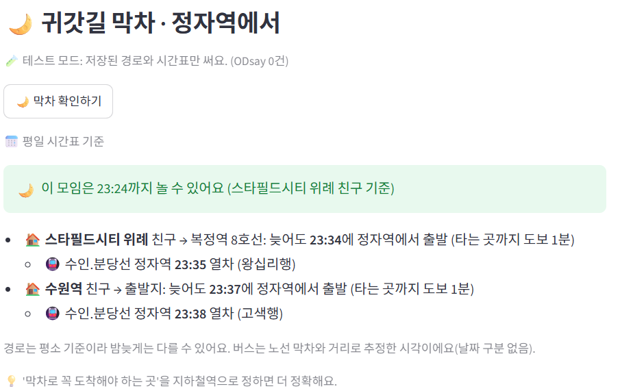
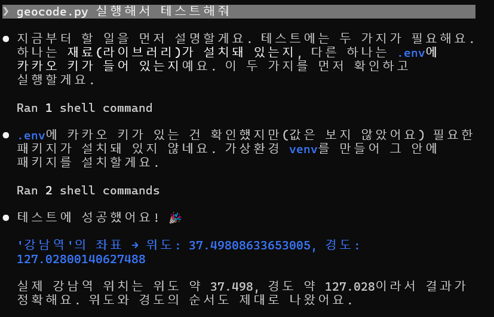
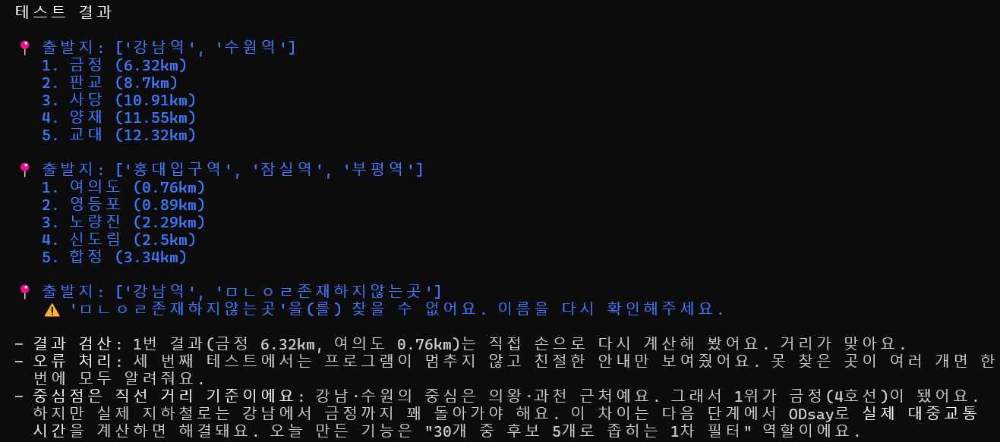
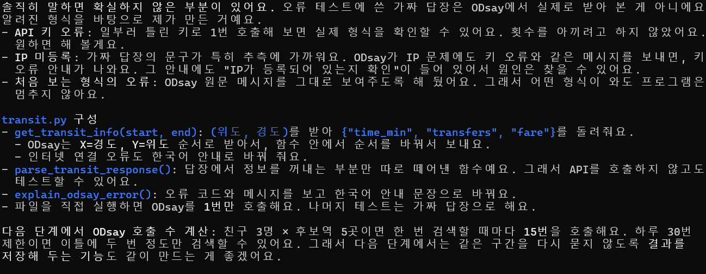
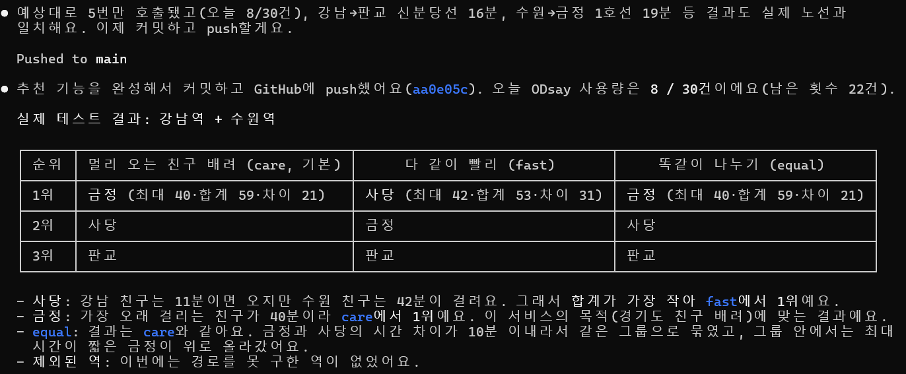
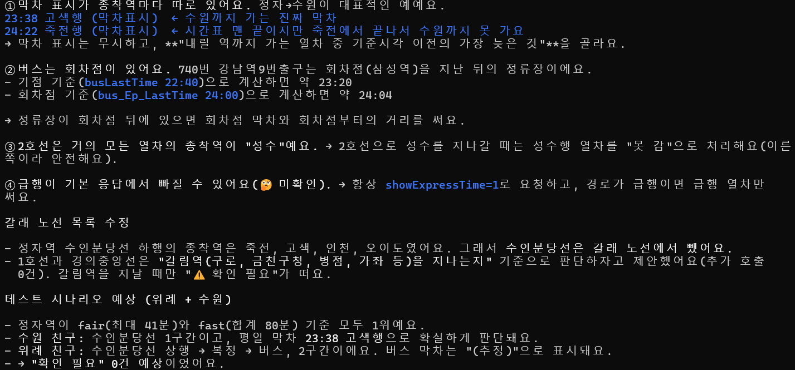
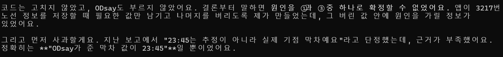
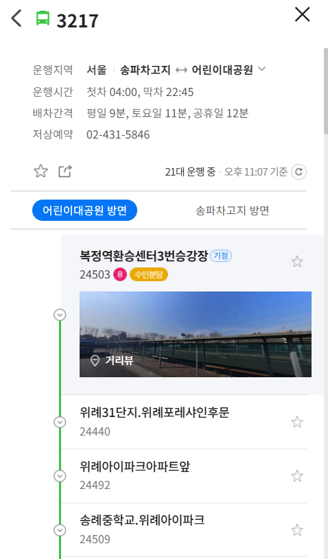
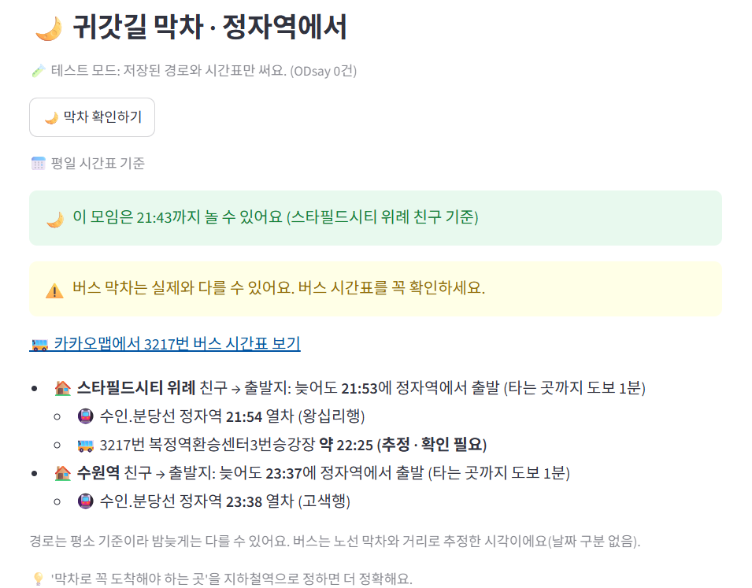

# 🚇 오늘은여기서

수도권 친구들의 출발지를 넣으면, 대중교통 소요시간을 기준으로 모두에게 공정한 약속 장소(지하철역)를 추천하고, 귀갓길 막차까지 계산해 주는 Streamlit 웹앱입니다.

## 1. 프로젝트 소개

**목적.** 경기도에 사는 친구와 서울에서 만나면, 한 사람만 늘 멀리 오고 막차 때문에 일찍 헤어지게 됩니다. 막차 걱정 없이 늦게까지 놀고 싶어서 만들었습니다.

**대상 사용자.** 서울과 경기도에 흩어져 사는 2~3명의 친구 모임. 특히 "몇 시까지 놀 수 있지?"를 매번 직접 찾아보는 경기도 친구.



위례 친구가 복정역까지만 가면 되는 경우, 이 모임은 23:24까지 놀 수 있다고 계산한 화면입니다.

## 2. 실행 방법

### 공통 준비

```bash
git clone https://github.com/jcy1109/oneul-yeogi.git
cd oneul-yeogi
python -m venv venv
source venv/bin/activate        # Windows: venv\Scripts\activate
pip install -r requirements.txt
```

### API 키 없이 데모 실행

1. `.env` 파일 없이 `streamlit run app.py`를 실행하면 자동으로 **데모 모드**가 됩니다. 테스트 모드가 켜진 채로 잠기고, ODsay와 카카오를 부르지 않습니다.
2. 사이드바의 **저장된 예시 불러오기**를 누르면 "스타필드시티 위례 + 수원역"이 채워집니다.
3. **약속 장소 추천받기** → 1위 정자역이 나옵니다.
4. 첫 번째 친구의 "막차로 꼭 도착해야 하는 곳"에 `복정역`을 넣고 **🌙 막차 확인하기** → 평일 23:24. 빈칸으로 두면 3217번 버스 때문에 21:43이 나옵니다.

데모 데이터는 `demo_data/`에 있으며, 이 예시에 필요한 공공장소 3곳의 좌표와 이동시간, 시간표만 담았습니다.

### 키를 넣고 실제 실행

1. `.env.example`을 `.env`로 복사하고 `KAKAO_REST_API_KEY`, `ODSAY_API_KEY`를 넣습니다.
2. ODsay 콘솔에 **실행하는 컴퓨터의 IP를 등록**해야 합니다. 등록하지 않으면 키가 맞아도 인증 오류가 납니다.
3. `streamlit run app.py` 실행 후 사이드바의 테스트 모드를 끕니다.
4. **ODsay는 하루 30건**까지입니다. 추천 1번에 최대 10건, 막차 확인은 친구 1명당 최대 3건을 씁니다. 한 번 조회한 구간은 `data/`에 저장해 다시 부르지 않습니다.

### 테스트 실행

```bash
for f in test_*.py; do python $f; done
```

## 3. 주요 기능

1. **공정한 약속 장소 추천.** 출발지 중심에서 가까운 후보역을 고른 뒤, 친구별 실제 대중교통 시간으로 순위를 매깁니다.
   - ⚖️ 공평하게: 가장 오래 걸리는 친구의 시간이 짧은 순
   - ⚡ 빠르게: 모두의 이동시간 합이 짧은 순
2. **집부터 경로 안내.** 주소나 건물 이름으로 출발지를 받고, 집에서 첫 역까지 걷는 구간부터 갈아타는 곳까지 보여줍니다.
3. **모임 시간 플래너.** 약속 시각을 넣으면 친구별 출발 시각을 계산합니다. 1위 역에서 각자 귀가 목표 지점까지의 막차를 거꾸로 계산해 "이 모임은 몇 시까지 놀 수 있는지" 알려줍니다.

## 4. 작업 과정과 주요 결정

- **10/14 뼈대:** 카카오 좌표 변환, 후보역 30곳, 출발지 중심점에서 가까운 역 고르기.
- **직선거리 → 실제 대중교통 시간:** 강남+수원의 중심점은 금정이지만, 강남에서 금정은 돌아가야 합니다. 그래서 ODsay 소요시간과 캐시, 하루 30건 한도 관리를 넣었습니다.
- **기준 3개 → 2개:** care, fast, equal을 실제 데이터(강남+수원)로 비교해 보니 equal이 care와 같은 결과를 냈습니다. 그래서 공평하게(fair)와 빠르게(fast)만 남겼습니다.
- **출발지를 역 → 집 주소:** 실제로는 집에서 출발하므로, 주소 검색 후 후보 3곳 중에서 고르게 바꿨습니다.
- **맛집 기능 제거 → 모임 시간 플래너:** 직접 써보니 맛집 결과가 대부분 프랜차이즈였습니다. 그래서 약속 시각과 친구별 출발 시각으로 방향을 바꿨습니다.
- **막차 전 "0단계":** 코딩 전에 실제 호출 6건으로 응답 형식을 확인했습니다. 막차 표시가 종착역마다 따로 붙는 점, 버스 회차점 같은 설계 변경을 미리 찾았습니다.
- **"막차로 꼭 도착해야 하는 곳" 입력:** 마지막 구간은 택시나 가족 차로 갈 수도 있고, 버스 막차는 추정이라 부정확합니다. 그래서 친구마다 목표 지점을 정할 수 있게 했습니다(복정역 23:24, 집 21:43).
- **제출 준비:** 키 없이 실행할 수 있도록 데모 모드와 `demo_data/`를 추가했습니다.

## 5. Claude Code 사용 증거


에이전트가 할 일을 먼저 설명하고, 강남역 좌표를 실제 위치와 대조했습니다.


중심점 직선거리로는 금정이 1위지만 실제 경로는 돌아간다는 한계를 짚었습니다.


가짜 오류 답장은 실제로 받아 본 것이 아니라고 불확실한 부분을 밝혔습니다.


기준 3개를 실제 데이터로 비교했고, equal이 care와 같아서 기준을 2개로 줄였습니다.


실제 호출로 찾은 설계 변경입니다. 정자→수원 막차는 24:22 죽전행이 아니라 23:38 고색행입니다.


에이전트가 3217번 버스 막차를 근거 없이 단정했던 것을 스스로 정정했습니다.

## 6. 검증 결과

| 항목 | 앱 결과 | 실제 확인 | 결과와 조치 |
|---|---|---|---|
| 역 좌표 | 강남역 37.498, 127.028 | 실제 위치 | 일치. 후보역 45곳 모두 수도권 범위 안 |
| 경로 | 강남→판교 신분당선 16분, 수원→금정 1호선 19분 | 카카오맵 길찾기 | 같은 노선 |
| ODsay 사용량 | 막차 확인 전 "최대 3건" 안내 | 호출 기록부 2건 | [확인 필요] |
| 정자→수원 막차 | 23:38 고색행 | 원본 시간표 | 맨 끝 24:22 죽전행은 수원까지 가지 않아 제외 |
| 3217번 버스 | ODsay 막차 23:45 → 정자역 23:23 열차, 모임 종료 23:12 | 네이버 22:45 | 원인: 막차 값이 하나뿐이라 회차점 쪽 막차로 보이고, 첫차·배차간격도 달랐음. 수정: 두 해석 중 이른 쪽(22:25)을 쓰고 "추정 · 확인 필요"와 경고 표시 → 21:43 |
| 복정역 목표 | 23:24 (위례 친구 기준) | 실제 호출 시연 | 테스트 모드와 같은 값. 테스트로 고정 |
| 양재역→잠실역 | 신분당선 양재 00:22 → 2호선 강남 00:38 | [확인 필요] | [확인 필요] |



네이버의 3217번 막차는 22:45로, ODsay 값 23:45와 1시간 차이가 났습니다.



수정 후 위례 친구 목표가 집이면 버스 구간에 "추정 · 확인 필요"와 경고가 붙습니다.

**자동 테스트:** 5개 파일, 82개 모두 통과했습니다. 카카오와 ODsay는 실제로 부르지 않고 가짜 답장과 저장된 실제 응답(`test_data/`)을 씁니다. 키와 캐시가 없는 환경에서도 통과하는 것을 확인했습니다.

| 파일 | 개수 | 내용 |
|---|---|---|
| test_app.py | 23 | 화면 동작, 영상 시나리오, 데모 모드 |
| test_geocode.py | 7 | 카카오 장소 검색 |
| test_last_train.py | 20 | 막차 거꾸로 계산, 갈래 노선, 버스 |
| test_recommend.py | 19 | 순위 기준, 경로 요약, 출발 시각 |
| test_transit.py | 13 | 캐시, 하루 한도, 오류 안내 |

## 7. 효과적이었던 실천 3가지

[직접 작성]

## 8. 어려웠던 점 3가지

[직접 작성]

## 9. 알려진 한계

- ODsay는 하루 30건이라 한 번에 친구 3명까지만 입력할 수 있습니다.
- 소요시간은 평균 기준이라 실제와 몇 분 다를 수 있습니다.
- 버스 막차는 노선 정보로 추정합니다. 일부러 실제보다 이른 쪽으로 계산합니다.
- 환승 3회 이상인 귀갓길과, 갈림역을 지나는 갈래 노선은 "확인 필요"로 표시합니다.
- 후보역은 고정된 45곳 명단에서만 고릅니다.
- 캐시는 약 100m 단위로 묶어서, 가까운 두 출발지가 같은 기록을 씁니다.
- 실시간 운행 정보(지연, 임시 열차)는 반영하지 않습니다.
- 배포하지 않았고 로컬에서만 실행합니다.

## 10. 채점용 핵심 파일

| 파일 | 역할 |
|---|---|
| `app.py` | Streamlit 화면. 입력, 결과 카드, 막차 표시 |
| `candidates.py` | 출발지 중심점에서 가까운 후보역 고르기 |
| `recommend.py` | 이동시간 표 만들기, 공평하게/빠르게 순위, 출발 시각 |
| `transit.py` | ODsay 호출, 캐시, 하루 30건 한도 |
| `last_train.py` | 시간표로 귀갓길 막차를 거꾸로 계산 |
